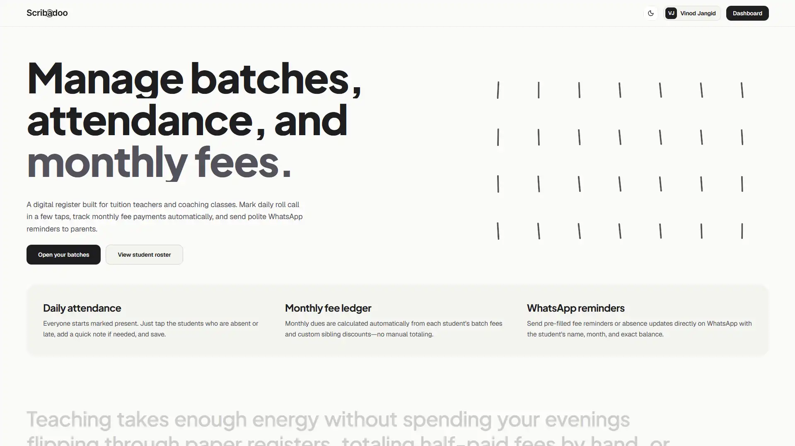

<div align="center">
  
  <h1>Scribadoo</h1>
  <p><strong>Modern Tuition Attendance & Fee Management for Independent Educators</strong></p>
  <p>
    <a href="https://scribadoo.vinodjangid.site"><strong>scribadoo.vinodjangid.site »</strong></a>
  </p>

  <p>
    
    
    
    
    
  </p>
</div>

<br />

<p align="center">
  
</p>

<br />

## Overview

**Scribadoo** is a specialized management dashboard engineered for tuition teachers, private tutors, and coaching institutes. It replaces disorganized paper registers, clunky spreadsheets, and fragmented WhatsApp chats with a single, high-craft digital command center.

Designed with an emphasis on speed, tactile minimalism, and zero cognitive clutter, Scribadoo streamlines day-to-day batch schedules, student attendance, monthly fee collection ledgers, digital invoicing, and parent communication.

---

## Key Features

### 📋 Batch & Student Management
- **Organized Rosters**: Group students across subjects, classes, and morning/evening shifts with customized schedules.
- **Student Dossiers**: Detailed student profiles storing enrollment dates, parent contact details, and attendance-to-payment histories.
- **Status & Capacity Tracking**: Real-time batch counts and active vs. inactive enrollment toggles.

### ⏱️ Rapid Daily Roll Call
- **One-Tap Attendance**: Take attendance for an entire batch in seconds with immediate present/absent toggling.
- **Turnout Metrics**: View daily turnout rates, average batch participation, and attendance trends over 7, 14, or 30-day windows.
- **Historical Attendance**: Audit and adjust attendance records across past dates with automated synchronization.

### 💳 Fee Ledger & Payment Tracking
- **Monthly Collection Overview**: Track total fees collected vs. pending balances for any academic month.
- **Overdue Triage**: Identify late payments immediately with automated past-due age calculation (e.g. `21d past due`).
- **Flexible Logging**: Record payments via UPI, Cash, or Bank Transfer with support for partial payments and multi-month settlement.

### 🧾 Branded Digital Receipts
- **Instant Receipt Generation**: Produce clean, itemized fee receipts complete with unique receipt numbers and date stamps.
- **Print & PDF Ready**: Designed for effortless printing or digital sharing with parents right from the dashboard.

### 💬 1-Click WhatsApp Parent Reminders
- **Direct Messaging**: Launch pre-formatted payment reminders and attendance notices straight to parent WhatsApp chats without saving individual phone numbers.
- **Custom Broadcasts**: Send batch-wide announcements, exam schedules, or emergency holiday notices in a single workflow.

### 📊 Financial & Operational Analytics
- **Visual Trends**: Clean Recharts-powered graphs highlighting student attendance curves and fee clearance percentages.
- **Attention Center**: Priority triage shelf highlighting urgent batch alerts and overdue students directly on the home view.

---

## Technical Architecture

```
scribadoo/
├── app/                  # Next.js App Router
│   ├── actions/          # Server Actions for mutations
│   ├── attendance/       # Daily roll call & attendance history
│   ├── batches/          # Batch scheduling & roster views
│   ├── dashboard/        # Operational overview & analytics
│   ├── fees/             # Monthly fee ledgers & receipt generation
│   ├── students/         # Student directory & profiles
│   ├── privacy/          # Privacy policy
│   └── terms/            # Terms of service
├── components/           # Reusable UI & domain-specific components
│   ├── attendance/       # Roll call modals & attendance tables
│   ├── batches/          # Batch cards & modal managers
│   ├── dashboard/        # Stats, charts & attention triage
│   ├── fees/             # Payment modals, fee tables & receipts
│   ├── shared/           # Header, navigation, theme toggles & modals
│   └── students/         # Student rosters & profile editors
├── context/              # React context for user & dashboard state
├── lib/                  # Utility helpers and formatters
├── types/                # TypeScript type definitions
└── public/               # Static assets, branding & preview media
```

---

## Author & Credits

Built & designed by [<u>Vinod Jangid</u>](https://vinodjangid.site).
